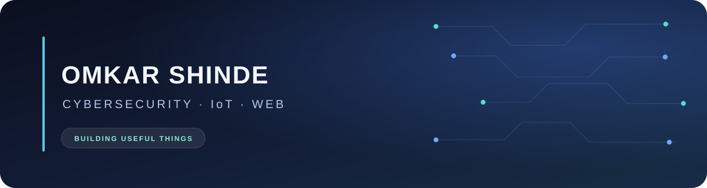

  

<h1 align="center">Hey, I'm Omkar Shinde 👋</h1>

  <strong>Electronics &amp; Telecommunication student</strong> · Cybersecurity · IoT · Web

  I enjoy building useful digital experiences and exploring how software, devices, and security meet.

  
  

---

### About me

- 🎓 B.Tech student in Electronics &amp; Telecommunication
- 🛡️ Interested in cybersecurity, IoT, and modern web technology
- 🧩 I like turning practical problems into clear, usable software
- 🌐 See more of my work on my [portfolio](https://omkarsx.github.io)

### Featured projects

| Project | What it is |
| --- | --- |
| [CyberGuard-AI](https://github.com/omkarsx/CyberGuard-AI) | An AI-based cybercrime detection and awareness project focused on spotting phishing and scams. |
| [AttendX](https://github.com/omkarsx/attendx) | An attendance project with QR scanning and a PostgreSQL-backed data layer. |
| [Pandurang Online Services](https://github.com/omkarsx/Pandurang-Online-Services) | A responsive digital services platform for online forms, document services, printing, and tech support. |

### Tools I work with

  
  
  
  
  
  
  
  

---

Thanks for stopping by — feel free to explore my repositories.

